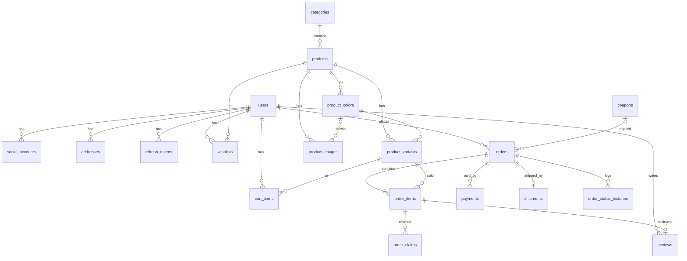

# DB 설계

PostgreSQL + Spring Data JPA 기준입니다. 스키마 변경은 **Flyway** 마이그레이션으로만 합니다.

## 공통 규칙

- **PK**: `BIGINT GENERATED ALWAYS AS IDENTITY` (`id`)
- **금액**: `BIGINT` 원 단위(부가세 포함). 소수점 없음
- **시간**: `TIMESTAMPTZ`. 모든 테이블에 `created_at`, `updated_at` (JPA Auditing)
- **열거형**: `VARCHAR` + JPA `@Enumerated(EnumType.STRING)`
- **삭제**: 주문이 참조하는 데이터(상품, 회원)는 실제로 지우지 않고 상태값으로 숨김
- **스냅샷**: 주문에는 당시의 상품명, 옵션, 가격, 배송지를 복사해 저장 (상품이 바뀌어도 주문 내역 유지)
- **이름**: 테이블과 컬럼은 `snake_case`, 테이블명은 복수형

## 범위 결정 (v1)

- **회원 주문만** 지원합니다. 소셜 로그인으로 가입 부담이 적어서 비회원 주문은 v2로 미룹니다.
- **비회원 장바구니**는 브라우저(localStorage)에 두고, 로그인하면 서버 장바구니로 합칩니다.
- **재고 단위**는 상품 × 색상 × 사이즈 조합(`product_variants`)입니다.

## ERD



## 테이블

### 회원

**users**

| 컬럼 | 타입 | 설명 |
|---|---|---|
| id | BIGINT PK | |
| email | VARCHAR(255) UNIQUE | 소셜 가입은 제공 동의 시에만 채워짐 (NULL 허용) |
| password_hash | VARCHAR(100) | BCrypt. 소셜 전용 회원은 NULL |
| name | VARCHAR(50) NOT NULL | |
| phone | VARCHAR(20) | |
| role | VARCHAR(20) NOT NULL | `USER`, `ADMIN` |
| status | VARCHAR(20) NOT NULL | `ACTIVE`, `WITHDRAWN` |
| marketing_agreed | BOOLEAN NOT NULL | 마케팅 수신 동의 |
| last_login_at | TIMESTAMPTZ | |
| withdrawn_at | TIMESTAMPTZ | 탈퇴 시 개인정보는 마스킹 |

**social_accounts**: 한 회원이 카카오·네이버를 모두 연결할 수 있습니다.

| 컬럼 | 타입 | 설명 |
|---|---|---|
| id | BIGINT PK | |
| user_id | FK → users | |
| provider | VARCHAR(20) NOT NULL | `KAKAO`, `NAVER` |
| provider_user_id | VARCHAR(100) NOT NULL | |
| | UNIQUE (provider, provider_user_id) | |

**refresh_tokens**

| 컬럼 | 타입 | 설명 |
|---|---|---|
| id | BIGINT PK | |
| user_id | FK → users | |
| token_hash | VARCHAR(64) UNIQUE | SHA-256. 원문은 저장하지 않음 |
| expires_at | TIMESTAMPTZ NOT NULL | |
| revoked_at | TIMESTAMPTZ | 로그아웃이나 재발급 시 기록 |

**addresses**

| 컬럼 | 타입 | 설명 |
|---|---|---|
| id | BIGINT PK | |
| user_id | FK → users | |
| label | VARCHAR(30) | 집, 회사 |
| recipient | VARCHAR(50) NOT NULL | |
| phone | VARCHAR(20) NOT NULL | |
| postal_code | VARCHAR(10) NOT NULL | |
| address1 | VARCHAR(255) NOT NULL | 도로명 주소 |
| address2 | VARCHAR(255) | 상세 주소 |
| is_default | BOOLEAN NOT NULL | 회원당 하나만 true |

### 상품

**categories**

| 컬럼 | 타입 | 설명 |
|---|---|---|
| id | BIGINT PK | |
| slug | VARCHAR(50) UNIQUE | `outerwear` 등 |
| name | VARCHAR(50) NOT NULL | |
| sort_order | INT NOT NULL | |
| visible | BOOLEAN NOT NULL | |

**products**

| 컬럼 | 타입 | 설명 |
|---|---|---|
| id | BIGINT PK | |
| slug | VARCHAR(100) UNIQUE | URL용 |
| category_id | FK → categories | |
| name | VARCHAR(100) NOT NULL | |
| description | TEXT | |
| price | BIGINT NOT NULL | 판매가 |
| original_price | BIGINT | 정가. 할인 시에만 |
| badge | VARCHAR(20) | `NEW`, `BEST`, `LIMITED`, `SALE` |
| material | VARCHAR(255) | |
| fit | VARCHAR(255) | |
| care | TEXT | 줄바꿈으로 구분 |
| status | VARCHAR(20) NOT NULL | `DRAFT`, `ACTIVE`, `HIDDEN` |
| featured_rank | INT | 추천순 정렬. 작을수록 앞 |
| published_at | TIMESTAMPTZ | 신상품 정렬 기준 |

**product_colors**

| 컬럼 | 타입 | 설명 |
|---|---|---|
| id | BIGINT PK | |
| product_id | FK → products | |
| name | VARCHAR(30) NOT NULL | 블랙 |
| hex | CHAR(7) NOT NULL | `#111111` |
| sort_order | INT NOT NULL | |

**product_variants**: 재고 관리 단위입니다.

| 컬럼 | 타입 | 설명 |
|---|---|---|
| id | BIGINT PK | |
| product_id | FK → products | |
| color_id | FK → product_colors | |
| size | VARCHAR(10) NOT NULL | `S`, `M`, `L`, `XL`, `FREE` |
| sku | VARCHAR(50) UNIQUE | |
| stock | INT NOT NULL CHECK (stock >= 0) | |
| active | BOOLEAN NOT NULL | 판매 중지 옵션 |
| | UNIQUE (product_id, color_id, size) | |

**product_images**

| 컬럼 | 타입 | 설명 |
|---|---|---|
| id | BIGINT PK | |
| product_id | FK → products | |
| color_id | FK → product_colors (NULL 허용) | 특정 색상 사진일 때 |
| storage_key | VARCHAR(255) NOT NULL | R2/S3 객체 키. URL은 설정값으로 조합 |
| alt | VARCHAR(255) | |
| sort_order | INT NOT NULL | 0번이 대표 이미지 |

### 장바구니, 위시리스트

**cart_items**

| 컬럼 | 타입 | 설명 |
|---|---|---|
| id | BIGINT PK | |
| user_id | FK → users | |
| variant_id | FK → product_variants | |
| quantity | INT NOT NULL CHECK (1~5) | 옵션당 최대 5개 |
| | UNIQUE (user_id, variant_id) | 같은 옵션은 수량만 증가 |

**wishlists**

| 컬럼 | 타입 | 설명 |
|---|---|---|
| id | BIGINT PK | |
| user_id | FK → users | |
| product_id | FK → products | |
| | UNIQUE (user_id, product_id) | |

### 쿠폰

**coupons**

| 컬럼 | 타입 | 설명 |
|---|---|---|
| id | BIGINT PK | |
| code | VARCHAR(30) UNIQUE | `TUK10` |
| name | VARCHAR(100) NOT NULL | |
| discount_type | VARCHAR(10) NOT NULL | `PERCENT`, `FIXED` |
| discount_value | BIGINT NOT NULL | 10(%) 또는 5000(원) |
| max_discount | BIGINT | 정률 할인 상한 |
| min_order_amount | BIGINT NOT NULL DEFAULT 0 | |
| starts_at / ends_at | TIMESTAMPTZ | |
| usage_limit | INT | 전체 사용 한도. NULL이면 무제한 |
| per_user_limit | INT NOT NULL DEFAULT 1 | |
| used_count | INT NOT NULL DEFAULT 0 | |
| active | BOOLEAN NOT NULL | |

회원별 사용 여부는 `orders.coupon_id`로 확인합니다. 단, 취소된 주문은 사용 횟수에서 뺍니다.

### 주문, 결제, 배송

**orders**

| 컬럼 | 타입 | 설명 |
|---|---|---|
| id | BIGINT PK | |
| order_number | VARCHAR(30) UNIQUE | `20261021-A1B2C3`. 외부 노출용 |
| user_id | FK → users | |
| status | VARCHAR(30) NOT NULL | 아래 상태 흐름 참고 |
| subtotal | BIGINT NOT NULL | 상품 합계 |
| discount | BIGINT NOT NULL | 쿠폰 할인 |
| shipping_fee | BIGINT NOT NULL | |
| total | BIGINT NOT NULL | 결제 금액 |
| coupon_id | FK → coupons (NULL 허용) | |
| recipient, recipient_phone, postal_code, address1, address2 | | 배송지 스냅샷 |
| delivery_memo | VARCHAR(255) | |
| orderer_name, orderer_email, orderer_phone | | 주문자 스냅샷 |
| paid_at / cancelled_at | TIMESTAMPTZ | |

**주문 상태 흐름**

```
PENDING_PAYMENT ─결제 승인─▶ PAID ─▶ PREPARING ─▶ SHIPPED ─▶ DELIVERED
      │                       │          │
      └─ 기한 초과 ─▶ EXPIRED   └─────────┴─ 취소 ─▶ CANCELLED (환불)
```

- 고객이 직접 취소할 수 있는 건 `PAID`까지입니다. `PREPARING`부터는 관리자만 취소할 수 있습니다.
- 반품·교환은 주문 상태를 바꾸지 않고 `order_claims`로 관리합니다.
- `PENDING_PAYMENT`가 30분 지나면 스케줄러가 `EXPIRED`로 바꿉니다.

**order_items**

| 컬럼 | 타입 | 설명 |
|---|---|---|
| id | BIGINT PK | |
| order_id | FK → orders | |
| variant_id | FK → product_variants | |
| product_id | BIGINT | 리뷰와 상품 링크용 |
| product_name, color_name, size, image_key | | 스냅샷 |
| unit_price | BIGINT NOT NULL | |
| quantity | INT NOT NULL | |
| line_total | BIGINT NOT NULL | |

**payments**: PG사가 바뀌어도 같은 테이블을 씁니다.

| 컬럼 | 타입 | 설명 |
|---|---|---|
| id | BIGINT PK | |
| order_id | FK → orders | |
| provider | VARCHAR(20) NOT NULL | `TOSS`, `PORTONE` |
| pg_payment_key | VARCHAR(200) UNIQUE | PG사 결제 식별자 |
| method | VARCHAR(30) | 카드, 간편결제 등 |
| status | VARCHAR(20) NOT NULL | `READY`, `PAID`, `FAILED`, `CANCELLED`, `PARTIAL_CANCELLED` |
| amount | BIGINT NOT NULL | |
| cancelled_amount | BIGINT NOT NULL DEFAULT 0 | |
| approved_at | TIMESTAMPTZ | |
| failure_reason | VARCHAR(255) | |
| raw_response | JSONB | PG 응답 원본 (카드번호 등 민감정보는 PG가 마스킹) |

**shipments**

| 컬럼 | 타입 | 설명 |
|---|---|---|
| id | BIGINT PK | |
| order_id | FK → orders UNIQUE | |
| carrier | VARCHAR(30) NOT NULL | `CJ`, `HANJIN`, `LOTTE`, `POST` |
| tracking_number | VARCHAR(50) NOT NULL | |
| shipped_at / delivered_at | TIMESTAMPTZ | |

**order_status_histories**: 누가 언제 상태를 바꿨는지 남깁니다.

| 컬럼 | 타입 | 설명 |
|---|---|---|
| id | BIGINT PK | |
| order_id | FK → orders | |
| from_status / to_status | VARCHAR(30) | |
| changed_by | FK → users (NULL이면 시스템) | |
| reason | VARCHAR(255) | |

**order_claims**: 반품, 교환 요청입니다.

| 컬럼 | 타입 | 설명 |
|---|---|---|
| id | BIGINT PK | |
| order_item_id | FK → order_items | |
| type | VARCHAR(20) NOT NULL | `RETURN`, `EXCHANGE` |
| reason_type | VARCHAR(30) NOT NULL | `CHANGE_OF_MIND`, `SIZE`, `DEFECT`, `WRONG_ITEM` |
| reason_detail | TEXT | |
| quantity | INT NOT NULL | |
| status | VARCHAR(20) NOT NULL | `REQUESTED`, `APPROVED`, `REJECTED`, `COMPLETED` |
| return_shipping_fee | BIGINT NOT NULL DEFAULT 0 | 단순 변심이면 고객 부담 |
| refund_amount | BIGINT | 완료 시 확정 |
| exchange_variant_id | FK → product_variants | 교환일 때 |

### 리뷰

**reviews**: 구매한 상품에만 쓸 수 있습니다.

| 컬럼 | 타입 | 설명 |
|---|---|---|
| id | BIGINT PK | |
| product_id | FK → products | |
| user_id | FK → users | |
| order_item_id | FK → order_items UNIQUE | 주문 상품당 리뷰 1개 |
| rating | SMALLINT NOT NULL CHECK (1~5) | |
| title | VARCHAR(100) | |
| body | TEXT NOT NULL | |
| height_cm | SMALLINT | |
| fit_feedback | VARCHAR(20) | `SMALL`, `TRUE`, `LARGE` |
| status | VARCHAR(20) NOT NULL | `VISIBLE`, `HIDDEN` (관리자 숨김) |

### 화면 운영 (관리자가 수정)

**banners**

| 컬럼 | 타입 | 설명 |
|---|---|---|
| id | BIGINT PK | |
| position | VARCHAR(30) NOT NULL | `MAIN_HERO`, `MAIN_MIDDLE`, `TOP_STRIP` |
| title / subtitle | VARCHAR(100) | |
| image_key / mobile_image_key | VARCHAR(255) | |
| link_url | VARCHAR(255) | |
| sort_order | INT NOT NULL | |
| starts_at / ends_at | TIMESTAMPTZ | 기간 노출 |
| active | BOOLEAN NOT NULL | |

**notices**

| 컬럼 | 타입 | 설명 |
|---|---|---|
| id | BIGINT PK | |
| title | VARCHAR(200) NOT NULL | |
| body | TEXT NOT NULL | |
| pinned | BOOLEAN NOT NULL | 상단 고정 |
| published | BOOLEAN NOT NULL | |

**store_settings**: 한 행(`id = 1`)만 둡니다. 관리자 설정 화면에서 수정합니다.

| 컬럼 | 타입 | 설명 |
|---|---|---|
| id | BIGINT PK CHECK (id = 1) | |
| store_name | VARCHAR(100) NOT NULL | |
| shipping_fee / free_shipping_threshold | BIGINT NOT NULL | 기본 3,000 / 50,000 |
| max_quantity_per_item | INT NOT NULL | 기본 5 |
| return_shipping_fee | BIGINT NOT NULL | 단순 변심 반품 왕복 배송비, 기본 6,000 |
| cs_phone, cs_email, cs_hours | | 고객센터 |
| company_name, ceo_name, registration_number, mail_order_number, business_address, privacy_officer | | 사업자 정보. 비어 있으면 화면에 "준비 중" |

### 구현하면서 추가한 테이블·컬럼

- **password_reset_tokens** (`user_id`, `token_hash` UNIQUE, `expires_at`, `used_at`): 비밀번호 재설정 링크 (30분)
- **payment_webhook_events** (`provider`, `event_key`, `payload` JSONB, UNIQUE (provider, event_key)): 같은 웹훅을 두 번 처리하지 않기 위한 기록
- `orders.order_name`(결제창 표시용 "상품명 외 N건"), `orders.coupon_code`(스냅샷), `orders.from_cart`(결제 후 장바구니에서 지울지)
- `order_items.product_slug`(상품 링크용 스냅샷)
- `reviews.option_label`("블랙 / M" 스냅샷), `reviews.order_item_id`는 NULL 허용(개발용 데모 리뷰)
- `product_colors.hex`는 `VARCHAR(7)`

실제 스키마는 `backend/src/main/resources/db/migration/V1__init.sql`이 기준입니다.

## 핵심 규칙

**재고 차감**: 결제 승인 시점에 조건부 UPDATE로 원자적으로 줄입니다. 재고가 부족하면 결제를 바로 취소합니다.

```sql
UPDATE product_variants SET stock = stock - :qty
WHERE id = :id AND stock >= :qty;   -- 영향받은 행이 0이면 품절
```

- 주문 취소나 반품 완료 시에는 재고를 다시 늘립니다.
- 결제 금액 검증: PG 승인 요청 전에 `orders.total`과 PG가 돌려준 금액이 같은지 반드시 확인합니다.

**금액 계산** (서버에서만 계산하고, 클라이언트 값은 믿지 않음)

```
subtotal     = Σ(unit_price × quantity)
discount     = 쿠폰 규칙 적용 (상품 금액 기준, max_discount 상한)
shipping_fee = subtotal >= 50,000 ? 0 : 3,000   ← 설정값으로 관리
total        = subtotal - discount + shipping_fee
```

## 주요 인덱스

- `products (status, category_id, featured_rank)`, `products (status, published_at DESC)`
- `product_variants (product_id)`, `product_images (product_id, sort_order)`
- `orders (user_id, created_at DESC)`, `orders (status, created_at DESC)`
- `reviews (product_id, status, created_at DESC)`
- `banners (position, active, sort_order)`
- 상품 검색: `products.name`에 `pg_trgm` GIN 인덱스 (50개 규모에서는 ILIKE로 시작하고, 상품이 늘면 적용)
